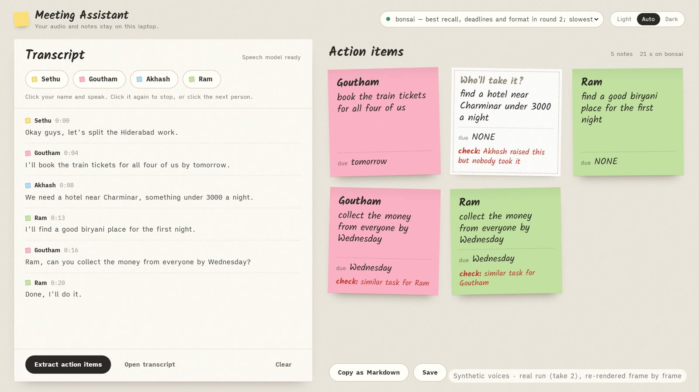

# Meeting Assistant: local, on an 8 GB laptop

A privacy-first meeting note-taker that runs entirely on a CPU-only, 8 GB laptop. Click your name,
talk; it transcribes with **Moonshine**, turns the meeting into **owner · task · deadline** with a
small open model (**Ternary Bonsai 4B** by default), and then checks the model's work in plain code.
Audio and notes never leave the machine.

Behind it is an eval of three small open models on this exact laptop, because the first question was
not "how do I build it" but "which model is good enough here, and what does each choice cost?"



**Demo video:** [youtu.be/XEpmtArXQPA](https://youtu.be/XEpmtArXQPA) (70 s, a scripted re-enactment; see below) · **Write-up:** _link coming (DEV)_

## What it does

- **Speaker buttons:** click your name, speak, click the next person. Exact names, no guessing.
- **Speech-to-text on CPU** with Moonshine, about 10× faster than real time here.
- **Action items as sticky notes**, one colour per owner. Tasks nobody committed to land on a white
  card asking *"Who'll take it?"*, and anything doubtful is marked in red pencil.
- **Checks in code, not in the prompt** (each one exists because the eval found the failure):
  - "We need X," said by someone who never took it → the task goes to nobody, not to the speaker
  - similar tasks for different people → both flagged, never merged
  - a deadline the model dropped but the sentence said → filled in and flagged
  - a "we need…" no task covers → listed as *Possibly missed*

## What the eval found

8 meetings (53 gold items written before any model ran) + 2 held-out, three models, thinking on/off,
on a Ryzen 3 4300U with single-channel DDR4 (21.3 GB/s).

| | |
|---|---|
|  |  |

- **Speed is arithmetic:** memory bandwidth ÷ model size predicts tokens/s. The Q4 models reach
  72–73% of that ceiling; the 2-bit ternary model only 45%.
- **Thinking mode cost ~10× the time and found fewer items;** 7 of 16 thinking runs ran out of
  budget before answering.
- **Finding tasks is easy (91–94% recall); owners are hard.** "We need…" goes to whoever said it.
- **A system prompt fixed invented deadlines (6 → 0) and the format, but not owners.**
  Ten lines of code did: 11 wrong owners fixed, 0 false alarms (written after seeing those meetings).

Full method, numbers and limits: [`eval/README.md`](eval/README.md).

## Quick start (Windows, PowerShell)

```powershell
python -m venv .venv
.\.venv\Scripts\Activate.ps1
pip install -r requirements.txt
pip install -e .

.\scripts\start_bonsai.ps1        # in its own terminal; model download: eval/01-setup.md
# or: ollama pull phi4-mini  /  ollama pull granite4.2:3b

meeting-assistant check           # which model servers are up
meeting-assistant serve           # http://127.0.0.1:8765
```

Participants and model servers live in [`meeting-assistant.toml`](meeting-assistant.toml). More:
[`meeting_assistant/README.md`](meeting_assistant/README.md).

## Repository map

| path | what |
|---|---|
| `meeting_assistant/` | the app: pipeline (`core.py`), speech, CLI, local web app |
| `eval/`, `eval_runner.py`, `gold.md`, `prompts/` | the eval: protocol, gold set, harness, scoring, results, limitations |
| `runs*.csv`, `scores*.csv`, `outputs*/` | every run's timings, scores and full model output |
| `tests/` | unit tests, regression replay of the 30 round-2 answers, web API, browser mic test |
| `demo/` | the demo video's scripts and both take logs |

## About the demo video

It is a **scripted re-enactment**. The app was first used live, offline, with friends planning a trip
to Hyderabad; screen-recording a live meeting wasn't feasible on this 8 GB laptop. So the video replays
one scripted take: synthetic voices (Kokoro) are fed into the real app as its microphone, and the real
transcription, notes and timings are re-rendered frame by frame. The first take was discarded because
it exposed a bug (the first half-second of every turn was lost), now fixed and tested. Details and
both logs: [`demo/README.md`](demo/README.md).

## Limits

Clean, scripted test meetings; English only; real voices, accents and crosstalk untested beyond the
author's own mic tests; one laptop. See [`eval/07-limitations.md`](eval/07-limitations.md).

## Credits

Open models and tools: [Moonshine](https://github.com/moonshine-ai/moonshine) (speech),
Ternary Bonsai via PrismML's llama.cpp fork ([Bonsai-demo](https://github.com/PrismML-Eng/Bonsai-demo)), Granite 4.2 3B and
Phi-4-mini via [Ollama](https://ollama.com), [Kokoro](https://huggingface.co/hexgrad/Kokoro-82M)
(demo voices only), FastAPI. Fonts: Kalam (Indian Type Foundry, OFL) and iA Writer Quattro (OFL),
licences in `meeting_assistant/web/static/fonts/`.

## License

MIT ([LICENSE](LICENSE)). Fonts keep their own OFL licences; models keep theirs (see each model card).
