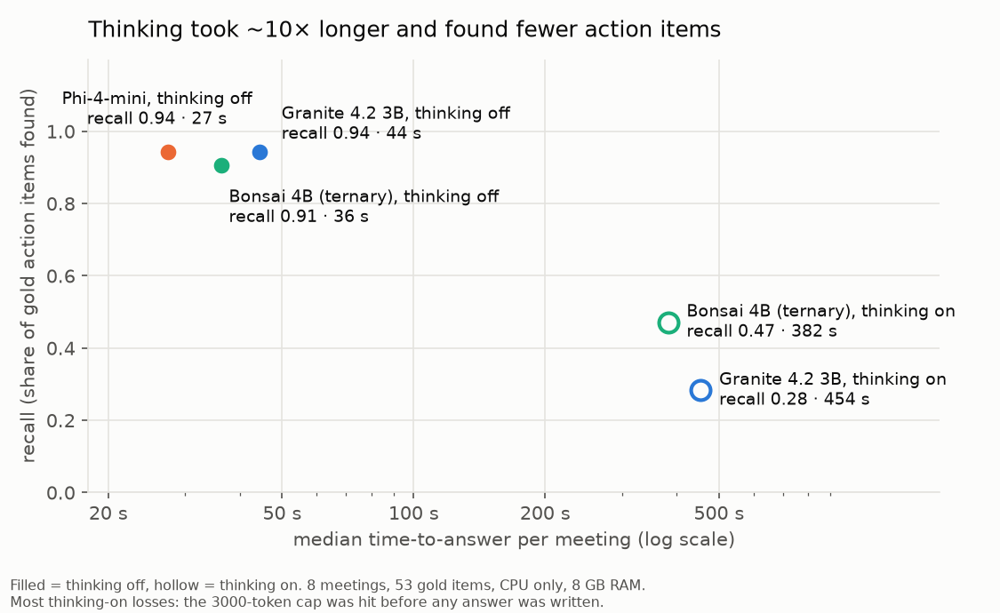
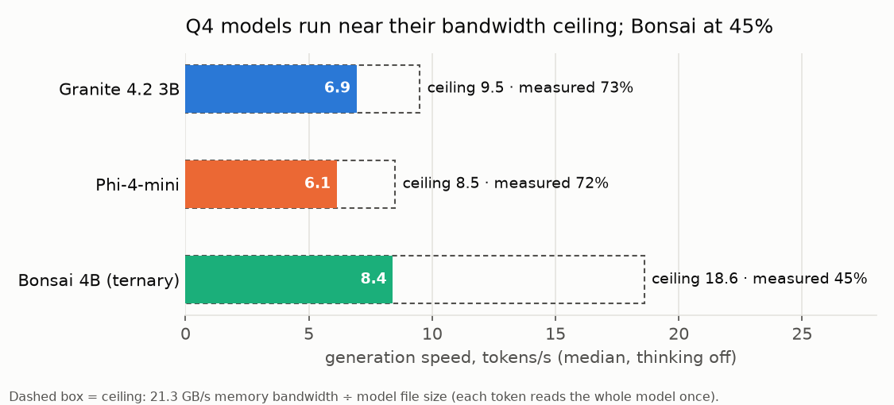

# 03 · Results

_Generated by `eval/report.py` from `runs.csv` and `scores.csv`. Tables only, no opinions; interpretation is in [04-analysis.md](04-analysis.md). Do not edit by hand: change the labels and re-run._

## Quality summary (pooled over 8 meetings)

Recall, precision, owner and deadline accuracy are pooled: counts summed over all meetings, then divided, so every gold item weighs the same. Ambiguity is the mean over the 8 UNASSIGNED items (2 = flagged, 1 = omitted, 0 = invented an owner).

| model | thinking | recall | recall S / M / L | precision | owner | deadline | invented deadlines | contradicting duplicates | ambiguity | format valid |
|---|---|---|---|---|---|---|---|---|---|---|
| Granite 4.2 3B | off | 0.94 (50/53) | 1.00 / 0.93 / 0.92 | 0.96 | 0.84 | 0.96 | 0 | 4 | 0.25 | 7/8 |
| Phi-4-mini | off | 0.94 (50/53) | 1.00 / 0.93 / 0.92 | 0.96 | 0.78 | 0.86 | 6 | 3 | 0.00 | 8/8 |
| Bonsai 4B (ternary) | off | 0.91 (48/53) | 1.00 / 0.93 / 0.83 | 0.98 | 0.92 | 0.85 | 6 | 2 | 1.25 | 5/8 |
| Bonsai 4B (ternary) | on | 0.47 (25/53) | 0.71 / 1.00 / 0.00 | 1.00 | 0.84 | 0.96 | 0 | 0 | 0.62 | 5/8 |
| Granite 4.2 3B | on | 0.28 (15/53) | 0.57 / 0.00 / 0.29 | 1.00 | 0.93 | 1.00 | 0 | 0 | 0.88 | 4/8 |

## Efficiency summary (medians over 8 meetings)

Time-to-answer = `wall_s − load_s`. Ceiling = memory bandwidth (21.3 GB/s) ÷ model file size. RAM delta is system-wide (used minus idle baseline) and rose within batches, so it is an upper bound on the model's footprint (see [07-limitations.md](07-limitations.md)).

| model | thinking | time-to-answer s | gen tok/s | % of ceiling | prompt tok/s | output tok | thinking share | hit 3000-token cap | max RAM delta GB |
|---|---|---|---|---|---|---|---|---|---|
| Granite 4.2 3B | off | 44 | 6.9 | 73% | 51.8 | 252 | 0% | 0/8 | 2.56 |
| Phi-4-mini | off | 27 | 6.1 | 72% | 48.0 | 131 | 0% | 0/8 | 2.81 |
| Bonsai 4B (ternary) | off | 36 | 8.4 | 45% | 17.6 | 166 | 0% | 0/8 | 2.86 |
| Bonsai 4B (ternary) | on | 382 | 7.3 | 39% | 15.7 | 2690 | 97% | 3/8 | 2.94 |
| Granite 4.2 3B | on | 454 | 5.7 | 60% | 45.8 | 2642 | 98% | 4/8 | 3.21 |

## Per-run log

| model | thinking | meeting | tier | prompt tok | output tok | gen tok/s | time-to-answer s | finish | recall | precision | owner | deadline | format |
|---|---|---|---|---|---|---|---|---|---|---|---|---|---|
| Granite 4.2 3B | off | m01_pricing | S | 119 | 163 | 7.08 | 27 | stop | 1.0 | 1.0 | 0.75 | 1.0 | 1 |
| Granite 4.2 3B | off | m02_offsite | S | 146 | 97 | 7.3 | 17 | stop | 1.0 | 1.0 | 0.667 | 1.0 | 1 |
| Granite 4.2 3B | off | m03_newsletter | S | 186 | 110 | 7.17 | 20 | stop | 1.0 | 1.0 | 0.667 | 1.0 | 1 |
| Granite 4.2 3B | off | m04_workshop | S | 137 | 95 | 7.28 | 17 | stop | 1.0 | 1.0 | 0.5 | 1.0 | 1 |
| Granite 4.2 3B | off | m05_sprint | M | 420 | 342 | 6.69 | 61 | stop | 1.0 | 1.0 | 0.889 | 1.0 | 1 |
| Granite 4.2 3B | off | m06_launch | L | 926 | 477 | 5.92 | 103 | stop | 0.867 | 0.929 | 0.923 | 0.846 | 1 |
| Granite 4.2 3B | off | m07_postmortem | L | 757 | 419 | 6.36 | 84 | stop | 1.0 | 0.9 | 0.889 | 1.0 | 0 |
| Granite 4.2 3B | off | m08_hiring | M | 313 | 427 | 6.79 | 71 | stop | 0.833 | 1.0 | 1.0 | 1.0 | 1 |
| Phi-4-mini | off | m01_pricing | S | 99 | 140 | 6.16 | 27 | stop | 1.0 | 1.0 | 0.75 | 1.0 | 1 |
| Phi-4-mini | off | m02_offsite | S | 123 | 89 | 6.27 | 18 | stop | 1.0 | 1.0 | 0.667 | 1.0 | 1 |
| Phi-4-mini | off | m03_newsletter | S | 152 | 87 | 6.27 | 19 | stop | 1.0 | 1.0 | 0.333 | 1.0 | 1 |
| Phi-4-mini | off | m04_workshop | S | 114 | 112 | 6.26 | 22 | stop | 1.0 | 1.0 | 0.5 | 1.0 | 1 |
| Phi-4-mini | off | m05_sprint | M | 363 | 231 | 6.04 | 48 | stop | 0.889 | 0.889 | 0.875 | 1.0 | 1 |
| Phi-4-mini | off | m06_launch | L | 832 | 206 | 5.75 | 57 | stop | 0.867 | 1.0 | 0.923 | 0.923 | 1 |
| Phi-4-mini | off | m07_postmortem | L | 679 | 237 | 5.61 | 59 | stop | 1.0 | 1.0 | 0.778 | 1.0 | 1 |
| Phi-4-mini | off | m08_hiring | M | 271 | 122 | 6.1 | 28 | stop | 1.0 | 0.857 | 0.833 | 0.0 | 1 |
| Bonsai 4B (ternary) | off | m01_pricing | S | 114 | 121 | 8.26 | 20 | stop | 1.0 | 1.0 | 1.0 | 1.0 | 0 |
| Bonsai 4B (ternary) | off | m02_offsite | S | 141 | 87 | 8.88 | 18 | stop | 1.0 | 1.0 | 0.667 | 1.0 | 0 |
| Bonsai 4B (ternary) | off | m03_newsletter | S | 180 | 114 | 8.64 | 25 | stop | 1.0 | 1.0 | 1.0 | 1.0 | 1 |
| Bonsai 4B (ternary) | off | m04_workshop | S | 134 | 138 | 8.75 | 23 | stop | 1.0 | 1.0 | 1.0 | 1.0 | 0 |
| Bonsai 4B (ternary) | off | m05_sprint | M | 415 | 195 | 8.55 | 56 | stop | 0.889 | 1.0 | 0.875 | 0.875 | 1 |
| Bonsai 4B (ternary) | off | m06_launch | L | 926 | 279 | 7.88 | 125 | stop | 0.733 | 1.0 | 0.909 | 1.0 | 1 |
| Bonsai 4B (ternary) | off | m07_postmortem | L | 754 | 274 | 8.16 | 106 | stop | 1.0 | 1.0 | 1.0 | 1.0 | 1 |
| Bonsai 4B (ternary) | off | m08_hiring | M | 307 | 223 | 8.25 | 48 | stop | 1.0 | 0.857 | 0.833 | 0.0 | 1 |
| Bonsai 4B (ternary) | on | m01_pricing | S | 112 | 2821 | 7.35 | 389 | stop | 1.0 | 1.0 | 0.75 | 1.0 | 1 |
| Bonsai 4B (ternary) | on | m02_offsite | S | 139 | 2419 | 7.31 | 339 | stop | 1.0 | 1.0 | 0.667 | 1.0 | 1 |
| Bonsai 4B (ternary) | on | m03_newsletter | S | 178 | 1589 | 8.04 | 210 | stop | 1.0 | 1.0 | 1.0 | 1.0 | 1 |
| Bonsai 4B (ternary) | on | m04_workshop | S | 132 | 3000 | 7.3 | 419 | length | 0.0 | – | – | – | 0 |
| Bonsai 4B (ternary) | on | m05_sprint | M | 413 | 2125 | 7.55 | 316 | stop | 1.0 | 1.0 | 0.889 | 0.889 | 1 |
| Bonsai 4B (ternary) | on | m06_launch | L | 924 | 3000 | 6.75 | 534 | length | 0.0 | – | – | – | 0 |
| Bonsai 4B (ternary) | on | m07_postmortem | L | 752 | 3000 | 6.83 | 512 | length | 0.0 | – | – | – | 0 |
| Bonsai 4B (ternary) | on | m08_hiring | M | 305 | 2558 | 7.28 | 375 | stop | 1.0 | 1.0 | 0.833 | 1.0 | 1 |
| Granite 4.2 3B | on | m01_pricing | S | 119 | 2284 | 6.21 | 372 | stop | 0.75 | 1.0 | 1.0 | 1.0 | 1 |
| Granite 4.2 3B | on | m02_offsite | S | 146 | 1532 | 6.32 | 248 | stop | 1.0 | 1.0 | 0.667 | 1.0 | 1 |
| Granite 4.2 3B | on | m03_newsletter | S | 186 | 1143 | 6.48 | 182 | stop | 0.667 | 1.0 | 1.0 | 1.0 | 1 |
| Granite 4.2 3B | on | m04_workshop | S | 137 | 3000 | 5.66 | 535 | length | 0.0 | – | – | – | 0 |
| Granite 4.2 3B | on | m05_sprint | M | 420 | 3000 | 5.37 | 569 | length | 0.0 | – | – | – | 0 |
| Granite 4.2 3B | on | m06_launch | L | 926 | 3000 | 4.91 | 634 | length | 0.0 | – | – | – | 0 |
| Granite 4.2 3B | on | m07_postmortem | L | 757 | 1730 | 5.64 | 326 | stop | 0.778 | 1.0 | 1.0 | 1.0 | 1 |
| Granite 4.2 3B | on | m08_hiring | M | 313 | 3000 | 5.47 | 556 | length | 0.0 | – | – | – | 0 |

## Charts

